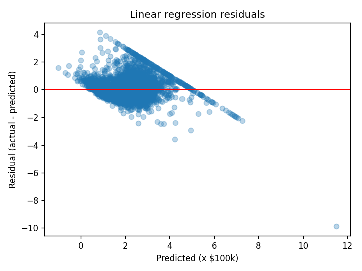

# California Housing Price Prediction (Linear Regression)

A hands-on supervised learning project: predict median house value for California census blocks, starting from a linear regression baseline and measuring what actually improves it.

**Task:** regression. **Target:** median house value (in units of $100,000). **Data:** scikit-learn's `fetch_california_housing` (20,640 rows, 8 numeric features).

## Approach

1. Explored the data (distributions, correlations, outliers).
2. Split once (80/20, `random_state=42`) and kept that test set untouched for every experiment.
3. Built a **mean-prediction baseline**, then a `StandardScaler + LinearRegression` pipeline (scaling lives inside the pipeline so no test information leaks).
4. Diagnosed errors with residual plots and coefficient inspection.
5. Tested fixes for outliers and feature engineering, then compared a non-linear model.

## Results (same full test set, 4,128 rows)

| Approach | RMSE | R² |
|---|---|---|
| Baseline (predict the mean) | 1.145 | 0.000 |
| Linear regression | 0.746 | 0.576 |
| Train on outlier-filtered rows, test on full set | 0.921 | 0.353 |
| **Linear regression + feature clipping (1%-99%)** | **0.670** | **0.657** |
| Random Forest (non-linear reference) | 0.505 | 0.805 |

RMSE is in units of $100k, so 0.746 means a typical error of about $75k.
Run `python src/train.py` to regenerate the table (saved to `results/metrics.csv`) and fill in the Random Forest row.

## Key findings

- **Linear regression beats the baseline clearly** (RMSE 1.145 to 0.746), with train R² 0.613 vs test R² 0.576. The small gap means it is **underfitting, not overfitting**: the model is too simple for the data.
- **A handful of extreme rows distort the metric.** Some census blocks have values like 1,243 average occupants or 141 average rooms. Three such rows in the test set accounted for roughly half of the total squared error in one experiment.
- **Removing outliers from training only made things worse (0.921)**, because the model then extrapolated wildly on extreme rows in the untouched test set. Linear models extrapolate badly outside the range they were trained on.
- **Clipping extreme feature values worked best.** Limits were learned from the training set only and applied to the test set, so the model stays robust to extreme inputs in new data.
- **Feature engineering barely helped** (bedrooms per room, log population: RMSE change under 0.001). The main limitation is the non-linear effect of location, not missing ratios.
- **Residual plot** shows a diagonal band from the target being capped at $500k, plus a tilt showing over-prediction at high prices and under-prediction at low prices.
- **Coefficients are not safe to read individually.** `AveRooms` and `AveBedrms` are strongly correlated (multicollinearity), so their signs are misleading.
- **A non-linear model closes most of the gap.** A default Random Forest reaches RMSE 0.505 (R² 0.805) on the same test set, about 32% lower error than plain linear regression. This confirms the linear model was underfitting, mainly because it cannot capture the non-linear effect of location. This is a quick reference with default settings, not a tuned model.



## Limitations

- Linear models cannot capture the non-linear effect of location (coast, big cities).
- About 5% of rows have the house value capped at $500k, which hides true values.
- Rows are census blocks, not individual houses.
- One train/test split; cross-validation would give a more stable estimate.
- Random Forest was not tuned or cross-validated

## How to run

```bash
python -m venv venv
source venv/bin/activate        # Windows: venv\Scripts\activate
pip install -r requirements.txt
python src/train.py
```

The exploratory work is in `notebooks/regression_exploration.ipynb`.

## Next steps

- Build linear regression from scratch with gradient descent (next project).
- Add cross-validation and regularization (Ridge, Lasso).
- Engineer location features (distance to major cities) to address the biggest limitation.
